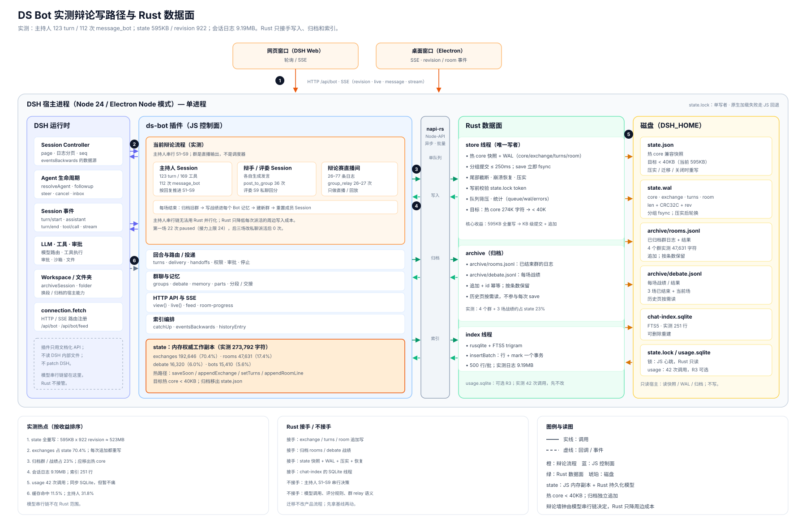
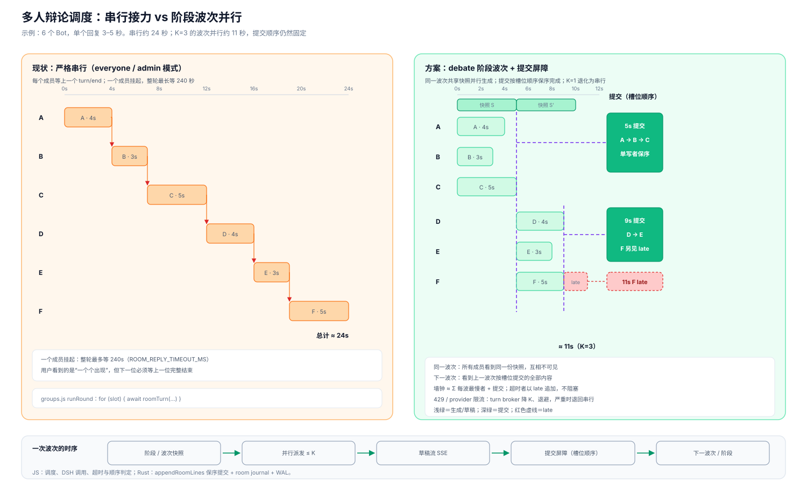

# 性能优化：Rust 核心（按实测辩论负载排序）

- 日期：2026-10-26
- 状态：**数据面方向已定：用 Rust 重写**。本文按 2026-10-25 本机真实辩论数据重排范围；当前辩论是主持人串行派活，波次并行未采用（见附录）。
- 相关代码：`ds-bot/src/host/store.js`、`delivery.js`、`turns.js`、`groups.js`、`debate.js`、`handoffs.js`、`channel.js`、`chat-index.js`、`usage.js`、`feed.js`、`src/client/index.js`、`src/client/cells.js`
- 相关 Issue：尚无。动工前按仓库流程开 Issue，分支从最新 `dev` 拉。

## 结论先行

实测数据把优先级排得很清楚：

1. **先做 state 拆分 + WAL**：`state.json` 595KB，revision 922，按全量重写估算约 523MB 写盘；`exchanges` 占 state 的 70%。这是 Rust 收益最大、风险最可控的一块。
2. **把归档数据移出热 state**：4 个群日志占 17%，`debate` 快照占 6%；热 core 可以从 274K 字符降到 40K 以下。
3. **索引出主线程**：会话日志 9.19MB，是 state 的 15 倍；本次索引只用了 251 行，但长历史/交接/`read_own_chat` 的数据量在这里。
4. **usage.sqlite 可选**：本次只有 42 次计费调用；它也是 `DatabaseSync`，但优先级低于 state 和索引。
5. **波次并行不做**：实测辩论是主持人串行派活 + 每场新群；没有阶段/波次代码路径。Rust 迁移不改变这个产品流程，也不承诺缩短 112 次串行模型调用。
6. **缓存命中率低**：整体 11.5%，主持人 31.8%。这是 token 成本和模型延迟问题，不是 Rust 能修的；记录为性能背景，不在本次范围。

**一句话：Rust 负责把 595KB 的全量写、9.19MB 的日志扫描和主线程 SQLite 拿走；它不负责把主持人 112 次串行模型调用变快。**

## 实测数据

数据来源：本机 `~/.ds-bot/bot`，2026-10-25 的 4 场辩论；只读统计，未修改任何文件。

### 队伍与场次

| 项 | 值 |
|---|---|
| Bot 总数 | 9 |
| 辩论成员 | 8（主持人、正反辩手、3 评委、事实核查、弹幕观众） |
| 群 | 4 个：3 个已归档 + 1 个当前 |
| 场次 | 4 场；`debate.matches` 3 场已结束，第 4 场 S9 已出结果 |
| 时间跨度 | 约 4.33 小时 |
| 主持人会话 | 123 个 turn，169 次工具调用 |
| 主持人工具分布 | `message_bot` 112、`post_to_group` 32、`ask_user` 6、`read_group_chat` 5 |

### state.json 构成与写放大

| 段 | 字符数 | 占比 |
|---|---:|---:|
| `exchanges`（224 条） | 192,646 | 70.4% |
| `rooms`（4 个群） | 47,631 | 17.4% |
| `debate`（规则、8 份 persona、3 场战绩） | 16,320 | 6.0% |
| `bots`（9 个） | 15,410 | 5.6% |
| `exchangeTurns` | 649 | 0.2% |
| 其余 | ~1,100 | 0.4% |
| **合计** | **273,792** | **100%** |

- 文件实际大小 595,333 字节（中文 UTF-8）。
- `revision = 922`；按每次全量重写估算：595,333 × 922 ≈ 523.5 MiB，平均每场约 131MB。
- 这是估算值，不是实际磁盘写入量（有页缓存、没有每次 fsync）；但 `JSON.stringify` 和写临时文件的 CPU/内存成本是实打实的。
- `exchanges`：224 条，正文合计 138,367 字符；单条 p95 1,636 字符，最大 2,000（`TEXT_KEPT` 截断）。
- 群日志：第一场 77 条 seq / 保留 60 行；后三场各 26 行。
- 第一场群有 8 个成员 Session；后三场 0 个（实现改成主持人私聊派活，群只做直播）。
- `debate.personas` 8 份 instructions 合计 12,088 字符；每场开始重写一次，之后随每次 `rt.save()` 一起重写。
- `debate.matches` 3 条结果，每条 400–573 字符；随场次线性增长。

### 会话日志与工具调用

| 项 | 值 |
|---|---|
| Session 数 | 22 |
| 原始事件 | 9,189,907 字节（约 9.19MB） |
| zstd 压缩后 | 3,630,399 字节（约 3.63MB） |
| 事件条数 | 5,070 |
| turn 数 | 397 |
| 工具调用 | 351 |
| 最大单会话 | 主持人：3.10MB 原始 / 1.09MB 压缩 / 123 turn / 169 工具 |
| 辩手单会话 | 约 1.00–1.02MB 原始 / 51–52 turn / 36 次 `post_to_group` |
| 群 Session | 26–30 turn / 26–27 次 `group_relay` |
| 评委 | 8–11 turn / 1 次 `ask_user` |

**会话日志是 state 的 15 倍**。`read_own_chat`、交接包、索引、记忆整理的输入都从这里来；本次辩论主要靠主持人和群日志，索引只用 251 行，但数据体量已经在那里。

### 主持人是串行瓶颈

- 主持人自己的 Session 是控制回路：S1→S9 的每一次派活都是一次 `message_bot`，对方回复后再继续。
- 112 次 `message_bot` + 112 条 reply ≈ 224 条 exchange 记录；每条 exchange 追加都会触发一次 `rt.save()`。
- 主持人的 123 个 turn 中，很多是工具回合（169 次工具调用），不是模型一次就结束；每次模型请求都带自己的历史。
- 这是**控制面的串行模型调用**，不是 SQLite、不是群 relay，也不是 Rust 能并行化的部分。
- 实测最大 turn 间隔：主持人 104 分钟（场间休息），辩手 104–109 分钟；场内群 Session 最大间隔 0.7–1.5 分钟，说明场上节奏本身不慢，慢的是场间和串行链。

### 群聊与暂停

- 第一场群有 23 条 notice，其中 **22 条是 `paused`**（接力上限 24），7 个 paused 成员，另有 1 条 `missed`。
- 后三场 0 条 pause：主持人改用私聊派活、辩手自己 `post_to_group`，绕开了群接力上限。
- 这不是 Rust 问题，是产品流程问题；但它说明**当前实现已经自己避开了“多人同时说话”**，不要再用并行去撞同一个坑。

### 索引与用量

| 项 | 值 |
|---|---|
| `chat-index.sqlite` | 251 行 `lines`，8 个 `marks` |
| `usage.sqlite` | 42 次计费调用 |
| 输入 token | 230,396 |
| 缓存读取 | 30,080（占输入+缓存 11.5%） |
| 输出 token | 14,464 |
| 主持人 | 10 次调用，44,492 输入，20,736 缓存（31.8%） |
| 用量最多 | 正方辩手 42,179 输入；主持人 44,492 |
| 模型 | `zcode/GLM-5-Turbo` 为主，少量 `deepseek-v4.1-flash` |

- 本次索引和 usage 都很小，**不能拿本次数据证明 Rust 索引的紧迫性**；但 9.19MB 日志和长历史会放大它们。
- `usage.js` 也用 `node:sqlite` 的 `DatabaseSync`，和 `chat-index.js` 一样是同步主线程；当前 42 次调用不痛，规模上来会痛。

### 缓存

- 整体缓存读取 30,080 / (230,396 + 30,080) = **11.5%**；主持人 20,736 / (44,492 + 20,736) = **31.8%**。
- 主持人的历史每 turn 都在增长；如果前缀不稳定（时间、记忆、动态 brief），缓存命中会一直低。
- 这是模型成本和首 token 延迟问题，**Rust 不修**。本方案只把它作为背景，不承诺解决。

## 实测结论

1. **state 拆分是第一位**：224 条 exchange、922 次 revision、595KB 全量写；不做这个，Rust 的其他部分收益都排在后面。
2. **归档数据要移出热路径**：4 个群 + 3 场战绩 + 8 份 persona 占 23%；热 core 目标 40KB 以下。
3. **索引第二**：9.19MB 日志 vs 595KB state；当前 251 行不代表未来。
4. **usage 第三/可选**：42 次调用，先记着，不要为它先做一套 Rust 模块。
5. **波次并行不做**：当前没有这个代码路径；产品流程是主持人串行。Rust 迁移不应该顺带改产品行为。
6. **Rust 不缩短模型串行链**：112 次 `message_bot` 仍是 112 次模型往返；Rust 只让每次往返的周边成本变低。
7. **缓存命中低是独立问题**：如果目标是“辩论更快”，下一步要看 prompt/前缀，而不是继续加 Rust 模块。

## 当前辩论流程（实测）



实测流程：

1. 主持人在自己的 Session 里按 S1–S9 串行推进；每次用 `message_bot` 把任务发给一个成员，等回复后继续。
2. 辩手在自己的 Session 里生成发言，用 `post_to_group` 发到「辩论赛直播间」；群 Session 通过 `group_relay` 把发言广播给其他成员。
3. 评委在 S9 前保持静默，S9 用 `ask_user` 把评分私聊回主持人；主持人汇总后在群里公布结果。
4. 一场结束，`debate.start` 归档旧群、写战绩到每个 Bot 的记忆、创建新群、重置各成员 Session；下一场从零开始。
5. 每一次 exchange 追加、群日志追加、`debate` 状态变化都调用 `rt.save()`，写整个 595KB state；`revision + 1` 后客户端拉全量。

Rust 的插入点：

| 现路径 | Rust 接手 |
|---|---|
| `delivery.js` 追加 exchange + `rt.save()` | `store.appendExchange(entry)`：WAL 追加，不重写 state |
| `turns.js` mark/unmark + `rt.save()` | `store.setTurns(sessionId, turns)` |
| `postToRoom` / `appendRoom` + `rt.save()` | `store.appendRoomLine(roomId, line)`；热 core 只留活动群最近行 |
| `debate.start` 归档旧群/战绩 + `rt.save()` | `store.appendArchive(record)`；归档不进热 core |
| `chat-index.js` `DatabaseSync` | Rust index 线程 |
| `usage.js` `DatabaseSync`（可选） | Rust usage 线程或并入 store |

**Rust 不接手**：主持人的 S1–S9 串行决策、模型调用、群 relay 的语义、评委评分规则。这些留在 JS 控制面。

## Rust 范围（按实测重排）

### R1：state 拆分 + WAL（第一优先）

目标：把每次全量 595KB 写，变成热 core 的 KB 级分组提交 + 追加日志。

**拆分**

| 数据 | 归属 | 理由 |
|---|---|---|
| bots、prefs、questions/views/works、活动群元数据 | 热 core | 控制面经常读，必须同步可见 |
| `exchanges`（最多 600） | exchange 日志 | 占 70%，每次追加不重写全部 |
| 已归档群的日志 | archive | 占 17%，只在历史页读 |
| `debate.matches` | archive | 每场增长，历史页读 |
| `debate.personas` / rules | 热 core（当前场） | 16KB，算配置；换场时重写一次 |
| `exchangeTurns` | turns 日志 | 小，但高频 |

热 core 预计从 273,792 字符降到 **30–40K**（bots 15.4K + 当前 debate 13K + 活动群 ~5K + 杂项）。这是按实测构成算的，不是拍脑袋。

**写入路径**

- `save()`：持久提交，WAL 写完 + fsync。
- `saveSoon()`：分组提交，≤250ms；exchange、turns、room 用它。
- `appendExchange(entry)`：WAL 追加；内存里仍保留 600 条。
- `setTurns(sessionId, turns)`：小记录。
- `appendRoomLine(roomId, line)`：活动群追加；`state.json` 只留最近 60 行。
- `appendArchive(record)`：归档群/战绩；写 `archive/*.jsonl`，不入热 core。
- 压实：热 core 快照 + WAL 轮换；归档单独按条数保留，不参与每次压实。

**验收**

- 热提交 p95 < 5ms，无 > 16ms。
- 热 core 载荷 < 40KB（从 274K 字符）。
- 每场写盘 < 15MB（从估算 131MB）。
- 事件循环停顿 p99 < 50ms。
- 旧 `state.json` 迁移后语义等价，`.pre-rust` 备份存在。

### R2：索引出主线程（第二优先）

- `chat-index.js` 的翻日志、`historyEntry`、mark、超时逻辑保留；`DatabaseSync` 换成 Rust 索引线程。
- 500 行/批或 16ms 一批；行 + mark 一个事务。
- 保持 `chat-index.sqlite` 格式、`user_version = 3`、BM25/trigram 语义。
- 验收：251 行索引 catch-up < 50ms；9.19MB 日志扫描期间其他回合 p95 不劣化 > 5%；旧索引可复用。

### R3：usage 出主线程（可选）

- `usage.sqlite` 也是 `DatabaseSync`；但本次只有 42 次调用。
- 如果 R1 的 store 线程已经有队列，可以把 usage 行作为一类记录并入；否则等基线显示它真的阻塞再做。
- 不做也不影响本方案的核心收益。

### 不做

- 不做阶段/波次并行调度；当前产品没有这个流程，Rust 迁移不改行为。
- 不做 room transcript 新日志；实测群日志只占 17%，用 R1 的 room 记录足够。
- 不做 token 估算器；主导成本在 DSH 的 `deriveMessages()`，不在 5 行估算。
- 不做 tantivy；FTS5 够用。
- 不做 sidecar；先看 R1/R2 的实测。

## 存储格式

### 文件

| 文件 | 内容 | 写入者 | 说明 |
|---|---|---|---|
| `state.json` | 完整兼容快照，`version: 1` | store 线程 | 压实/迁移/关闭时重写；热路径不写 |
| `state.wal` | core / exchange / turns / room 记录 | store 线程 | 长度 + CRC32C 分帧；分组 fsync |
| `archive/rooms.jsonl` | 已归档群的日志与结果 | store 线程 | 追加；历史页按需读 |
| `archive/debate.jsonl` | 每场战绩 | store 线程 | 追加；`debate.matches` 的来源 |
| `chat-index.sqlite` | FTS5 索引 | index 线程 | 可删除重建 |
| `usage.sqlite` | 计费账本 | usage 线程或 JS | 可选 R3 |
| `state.lock` | 单写者心跳 | JS | Rust 写前读 token |
| `state.json.pre-rust` | 首次迁移备份 | initialize | 不自动删除 |

### WAL 分帧

```
文件头： "DSBW" | u16 version | u16 reserved
记录：   u32 len | u32 crc32c | u8 op | u64 rev | payload
op：     1 core | 2 exchange | 3 turns | 4 room
```

- `core`：热 core JSON（不含 exchanges、归档、已归档群日志）；KB 级。
- `exchange`：单条交换记录，按 id upsert；内存按 600 条截断。
- `turns`：`{sessionId, turns}`，整组替换。
- `room`：`{roomId, line}`；活动群日志；`state.json` 快照只保留最近 60 行。
- `rev` 由 JS 递增；store 只接受非递减；倒退返回 `EREV`。
- 归档不写 WAL 主体：`appendArchive` 直接追加 `archive/*.jsonl`，带 id 幂等；崩溃只影响最后一行，重放按 id 去重。

### 恢复

1. 有 `state.wal`：读 `state.json`，重放 `rev > snapshot.revision` 的记录；重建热 core、exchanges、turns、活动群日志。
2. 没有 `state.wal`：JS 读旧 `state.json`、跑 `adopt()`，再 `store.initialize(stateJson)` 建立快照和空 WAL；归档目录保留。
3. 归档：读 `archive/*.jsonl` 尾部，坏行截断；按 id 去重；缺失的历史场次只影响历史页，不影响当前场。
4. 快照损坏：返回 `ECORRUPT`；JS 用 `.broken-*` / `.pre-rust` 恢复；原生不静默重建。
5. WAL 尾记录损坏：写者截断到最后一条完整记录；只读宿主忽略尾部。
6. `adopt()` 返回 `migrated`：写者用 `replaceAll(stateJson)` 重置快照和 WAL；归档保留。

### 提交与背压

- store 线程持有热 core、exchanges（600）、turns、活动群 ring。
- 队列：core/turns 可合并；exchange/room 保序；archive 直接追加。
- 上限 32MiB / 1024 批；`commit()`/`appendExchange`/`appendRoomLine` 满时等待；`commitSoon()` 返回 `EBUSY`，下次 `save()` 重试。
- 磁盘满/EIO：标记 `degraded`；下一次 `save()` 用完整 state `replaceAll` 自愈。
- fsync：`save` 立即；`saveSoon` 分组窗口；exchange/room 随分组窗口；归档追加后 fsync。
- 关闭：flush + 排空队列；WAL > 256KB 时顺带压实。

### 压实

- 触发：WAL > max(4MiB, 2×快照) 或空闲 5 分钟。
- 克隆热 core → 写 `state.json.tmp`（含 revision）→ fsync → 原子替换 → WAL 轮换。
- 归档不参与：`archive/*.jsonl` 只按条数保留（例如每类 10,000 条），重写尾部。
- 崩溃窗口和现在一致：替换前/后、WAL 轮换前后都可重放；`exchange`/`turns`/`room` 幂等。

### 锁与只读宿主

- `home-lock.js` 不变；锁由 JS 持有。
- store 每次持久写前读 `state.lock`，比对 token；不一致 `ELOCKLOST`。
- `lockBroken` 时 token 为空，跳过校验。
- 只读宿主：读快照 + WAL + 归档；不写、不压实、不追加。
- `stamp()` 覆盖快照、WAL、归档目录的头部；`refresh()` 据此重新 adopt。

### Rust 与 JS 回退共存

- 启动时决定实现；不在运行中切换。
- 原生加载失败/无二进制/`DS_BOT_NO_NATIVE=1`：JS 回退。
- JS 回退读 WAL、读归档、写完整 `state.json`；写者首次保存后把 WAL 改名 `state.wal.orphan-<时间>`；不删除、不改归档。
- `native → fallback → native`、`fallback → native → fallback` 都进契约测试。
- 原生模块带 `apiVersion`；不匹配按加载失败处理。

### JS ↔ Rust 接口（v1）

```js
const store = nativeStore.open({
  dir,
  snapshot: 'state.json',
  wal: 'state.wal',
  lock: { path: 'state.lock', token },
  maxExchanges: 600,
})

await store.initialize(stateJson, { backup: true })
const loaded = await store.load()
// { initialized: true, stateJson, revision } | { initialized: false }

await store.commit({ revision, core })        // 持久提交（结构变化）
store.commitSoon({ revision, core })          // 分组提交（热路径）
await store.appendExchange(entryJson)         // exchange 追加
await store.setTurns(sessionId, turns)        // 回合号
await store.appendRoomLine(roomId, lineJson)  // 活动群日志
await store.appendArchive(kind, recordJson)   // rooms / debate 归档
const rows = await store.archive(kind, { limit, before }) // 历史页

await store.replaceAll(stateJson)             // 迁移 / degraded 自愈
await store.flush()
const stamp = store.stamp()
const stats = store.stats()
await store.close()
```

错误码：`EVERSION`、`ELOCKLOST`、`EBUSY`、`EREV`、`ECORRUPT`、`EIO`/`ENOSPC`。含义与处理沿用上一版。

### 索引

- `chat-index.js` 逻辑保留；Rust 索引线程持有 SQLite。
- `insertBatch(sessionId, rows, mark)` 一个事务；失败回滚。
- `catchUp` 500 行/批或 16ms；批间让出。
- 查询语义不变：长词 FTS5 短语、短词 LIKE、hidden 回合排除、排序/limit 不变。
- 索引损坏删除重建；旧索引可直接复用。

## 不变的行为

- 辩论流程：主持人串行 S1–S9、辩手 `post_to_group`、评委 S9 私聊、每场新群、战绩写记忆。
- 群聊的发言顺序、接力上限、暂停、迟到回复、4 分钟超时。
- `state.json` 对外形状、`adopt()`、双宿主只读、锁文件格式。
- `chat-index.sqlite` 的 schema、`user_version`、检索语义。
- JS 回退可用；`npm test`/`--check`/`lint` 不要求 Rust。
- `revision` 单调递增；分组提交可能跳号。

## 验收

### 行为

- `npm test`、`node scripts/build-client.mjs --check`、`npm run lint` 全绿。
- 旧 state 夹具迁移语义等价；双宿主、锁丢失、崩溃恢复与今天一致。
- 原生与 JS 回退契约测试一致；native → fallback → native 往返不丢数据。
- 打包后的桌面应用能加载 `.node`。
- 当前辩论流程（主持人串行、群直播、S9 评分）不改。

### 性能（同一台机器、同一份真实数据回放）

| 指标 | 现状（实测/估算） | 目标 |
|---|---:|---:|
| `state.json` 大小 | 595KB | 热 core < 40KB |
| revision 数 | 922 / 4 场 | 分组提交后显著减少；记录实测 |
| 全量重写估算 | ~523MB / 4 场 | 每场 < 15MB |
| 热提交 p95 | 待测 | < 5ms；无 > 16ms |
| 事件循环停顿 p99 | 待测 | < 50ms |
| 索引 catch-up（251 行） | 待测 | < 50ms |
| 9.19MB 日志扫描期间其他回合 p95 | 待测 | 不劣化 > 5% |
| usage 42 次调用 | 待测 | 不阻塞（R3 前可接受） |

**不承诺**：Rust 不会把 112 次主持人串行模型调用变少，也不会提高 11.5% 的缓存命中率。辩论墙钟的模型部分单独测量、单独优化。

### 怎么复测

- `state.json`：文件大小、`revision`、各段 JSON 字符数；用 `node` 读 `~/.ds-bot/bot/state.json` 只统计、不输出正文。
- usage：`usage.sqlite` 的 `calls` 表按 `kind`、`session` 聚合 `input`、`cache_read`、`output`。
- 会话日志：`.jsonl.zstd` 是多个 zstd 帧追加；逐帧解压后统计 `turn/start`、`tool/call`、`user/message`。
- 写放大：`state.json` 字节 × revision，只作上限估算；Rust 路径用 store 统计的 `walBytes`、`commitBytes` 实测。
- 辩论墙钟：从 S1 到 S9 的日志时间戳，按阶段汇总；与模型调用次数分开看。

## 分步实施

### 第 0 步：基线回放（1 周）

- 把本次 4 场数据做成只读夹具：`state.json`、`usage.sqlite`、22 个会话 zstd 帧。
- 用 `dev/bench.sh` + mock 模型复现主持人串行派活；记录 `save()` p50/p95、事件循环停顿、每场写盘。
- 产出基线报告；没有基线不做 Rust 优化。

### R1：store 拆分 + WAL（3–4 周）

1. `native/` workspace、napi 绑定、加载器、`apiVersion`、JS 回退开关。
2. WAL、分组提交、快照、压实、恢复、锁校验、背压、统计。
3. 拆分：热 core、exchange、turns、room、archive；`state.json` 兼容快照。
4. `delivery.js`/`turns.js`/`groups.js`/`debate.js` 接 `appendExchange`/`setTurns`/`appendRoomLine`/`appendArchive`。
5. 迁移、`.pre-rust`、JS 回退读 WAL/归档、往返测试。
6. 崩溃测试：WAL 尾、压实各崩溃点、归档尾、两个宿主、锁丢失、磁盘满、Windows 占用。

验收：见上表；`npm test` 全绿；旧 state 语义等价。

### R2：索引出主线程（2–3 周）

1. Rust 打开现有 `chat-index.sqlite`，保持 schema。
2. `insertBatch`/`setMark`/`search`/`latest`/`around`。
3. `catchUp` 分块；契约测试 JS/Rust 逐行一致。
4. 251 行夹具 + 9.19MB 日志回放。

### R3：usage 可选（3–5 天）

- 只有基线显示 `usage.sqlite` 阻塞，或 R1 的队列已有余力时才做。
- 并入 store 作为 `usage` 记录，或单独线程；不改变账本格式。

### 第 C 步：打包（3–5 天）

- 矩阵构建：`win32-x64-msvc`、`darwin-x64`、`darwin-arm64`、`linux-x64-gnu`；后续 `linux-arm64-gnu`。
- npm `files` 加 `native/`；`Cargo.lock` 提交；桌面 `asarUnpack` 加 `.node`；Windows 静态 CRT；macOS 签名校验。
- `DS_BOT_NO_NATIVE=1` 回退；CI 两条路径都跑。

### 建议 PR 拆分

| # | 内容 | 依赖 |
|---|---|---|
| 1 | 真实数据夹具 + 基线报告 | 无 |
| 2 | native workspace + 加载器 + 回退开关 | 1 |
| 3 | store 核心 WAL/快照/恢复（默认关） | 2 |
| 4 | 拆分 exchange/turns/room/archive + 接线 | 3 |
| 5 | 索引 Rust 化 + 契约测试 | 3 |
| 6 | usage（可选） | 4 |
| 7 | 打包/桌面/发布 | 2,4,5 |

每个 PR 单独可回退；第 4 个是收益最大的一个，也是评审重点。

## 风险与对策

| 风险 | 对策 |
|---|---|
| state 拆分/归档迁移出错 | `.pre-rust` 备份；旧夹具；`adopt()` 前后对拍 |
| 归档增长无界 | 每类保留上限（如 10,000 条）；历史页按需读；用户可清理 |
| WAL/归档尾损坏 | 行级 CRC/JSON 解析；截断到最后完整行；写者才截断 |
| 原生崩溃/panic | `catch_unwind`；I/O 不用 `unwrap`；运行中不切换；必要时 sidecar |
| 回退读取器与 Rust 漂移 | 同一批夹具双向回放；往返测试 |
| 双宿主锁被绕过 | 写前校验 token；`stamp()` 覆盖快照/WAL/归档 |
| 索引/usage 仍是同步 SQLite | R2/R3；R3 可按数据推迟 |
| 缓存命中低、模型串行 | 不在 Rust 范围；单独优化 prompt/前缀/流程 |
| Windows 文件替换/签名 | 忙等待替换；静态 CRT；签名校验 |
| IPC 开销 | 批量接口；用真实夹具对比 |

## 工作量

| 项 | 估算 |
|---|---|
| 基线回放 | 1 周 |
| R1 store 拆分 + WAL | 3–4 周 |
| R2 索引 | 2–3 周 |
| R3 usage（可选） | 3–5 天 |
| 打包/桌面/发布 | 3–5 天 |
| 合计 | 约 7–9 周（R2 可与 R1 后段并行） |

比上一版少掉的是：波次并行调度、room transcript、debate UI、token 估算器。这些在实测流程里没有对应代码路径或收益。

## 已知限制

- Rust 不减少 112 次主持人串行模型调用；辩论墙钟的模型部分不变。
- 缓存命中率 11.5%/31.8% 是模型/前缀问题，Rust 不修。
- 热 core 仍包含 bots 和当前 debate 配置；40KB 是目标，不是承诺。
- `state.json` 兼容快照可能落后 WAL；旧版本读到的不是最新。
- 归档保留上限会丢弃最老的场次；需要完整历史时导出。
- 冷启动仍要在 JS 主线程解析一次完整快照；Rust 省的是写入和索引。
- 首次迁移会写 `.pre-rust` 备份，磁盘占用增加一份 state。
- 当前辩论实现本身已避开群接力（后三场 0 pause）；Rust 不改这个流程。

## 待定问题

1. `archive/rooms.jsonl` 与 `archive/debate.jsonl` 的保留上限和清理入口。
2. `debate.personas` 是留在热 core，还是每场开始写独立文件（16KB，影响不大）。
3. `usage` 是并入 store 还是独立线程；等 R1 基线。
4. 索引是否也要吸收 `usage.sqlite` 的 mark/owners，还是保持两个库。
5. 旧版本降级读兼容快照的窗口有多长；是否需要迁移后立即压实一次。
6. 是否要把 `exchangeTurns` 从热核心移到 turns 日志（当前 649 字符，可留可移）。

## 附录：波次并行（未采用）



这张图是“如果产品决定改成阶段/波次并行”的备选设计，**不是当前实现**：

- 当前辩论是主持人串行派活 + 每场新群；没有 `debate` 模式、没有阶段/波次/提交屏障代码。
- 实测第一场 22 次 `paused`，后三场改用私聊派活后 0 次；产品已经用“串行 + 私聊”避开了并行冲突。
- 如果以后要做波次并行，需要单独的 `debate` 模式、产品规则和设计评审；它不属于 Rust 数据面迁移。
- 该备选的技术要点（快照、K、屏障、late、commitId）保留在图中，供未来评估；本方案不实现。

## 变更

- 2026-10-25：提案初稿。
- 2026-10-25：第二稿。确立 Rust 核心重写；补充数据面/控制面边界、WAL/快照、napi、索引批处理、打包与验收。
- 2026-10-25：第三稿。架构 SVG、线程模型、WAL 恢复/压实、背压、回退、错误码、可观测性。
- 2026-10-25：第四稿。以辩论为前提深入 JS 控制面，提出阶段/波次/槽位。
- 2026-10-25：第五稿。架构详图、9 步调用顺序、失败路径、图例。
- 2026-10-25：第六/七稿。状态机、幂等、SSE、测试矩阵、运行手册、备选方案。
- 2026-10-26：**按实测重写**。读取本机 4 场真实辩论数据（9 Bot、8 人辩论、595KB state、922 revision、224 exchange、9.19MB 会话日志、42 次计费调用）；砍掉未采用的波次并行主方案，按实测收益重排为 state 拆分 + WAL → 索引 → 可选 usage；补充实测表、真实写路径、验收数字和“不做/不承诺”清单。
